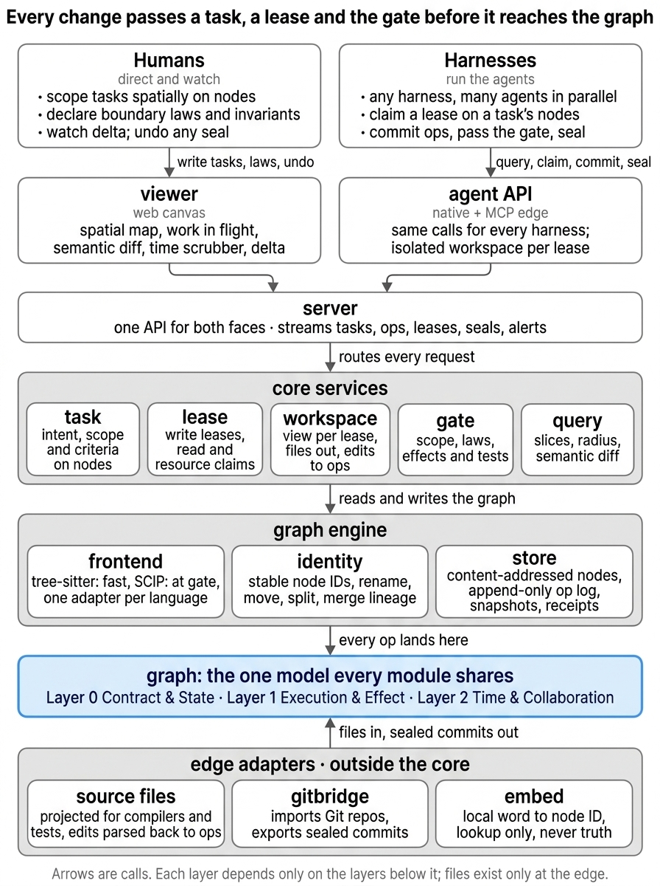

# Ora: Architecture & General Direction

November 16, 2026

## 1. The Idea & Boundaries

Ora is the canonical semantic repository for agent-written code: one graph holding the software model, the work wanted of it, and the verified record of what changed. The primary unit is a graph node (a data shape, function, edge, or effect), not a file or text line. Languages enter only through edge adapters.

Human attention is the hard constraint. Compute scales code production, not a human's ability to follow it. Ora moves human decisions before work (scoping tasks and declaring boundary laws) and keeps everything after legible and undoable.

- **The Harness Line:** Ora holds state; external harnesses run agents. Ora knows what is wanted, who holds which nodes, and what is proven—never what an agent is. Rule: if a feature does not survive a harness swap, it belongs in the harness.
- **What Ora Is Not:**
  - Not a harness or agent orchestrator (no launching agents, model selection, prompts, or transcripts).
  - Not a text editor (humans read, select, and write tasks; no cursor in a buffer).
  - Not a PR review queue (no human approves diffs; agents seal when the gate passes, and humans change tasks, update boundary laws, or undo seals).
  - Not a compiler or test runner (projects files for existing toolchains and records observed results).
  - Not Git in its write path (Git sits at the edge only via an import/export adapter).
  - Not built on embeddings (the graph is deterministic; local embeddings are lookup-only, never truth).

## 2. System Architecture

Every change passes a task, a lease, and the deterministic gate before reaching the graph. Dependencies are strictly one-way downward; source files exist only at the edge for existing toolchains.

## 3. Core Model, Identity & Provenance

One canonical store holds both the software structure and the work history, linked by stable node IDs.

| Layer | Primitives | Written By |
| --- | --- | --- |
| 0 · Contract & State | State (struct, class, interface, schema, field) and Boundary (subsystem read/write laws) | State extracted; Boundaries declared by humans |
| 1 · Execution & Effect | Transform (function, method), Edge (calls, reads, writes, returns, constructs), Effect (pure read, mutates field, allocates, I/O) | Extracted by frontend |
| 2 · Time & Collaboration | Task (intent, read/write scope, constraints, acceptance criteria), Lease, Op (micro-commit), Devlog (decisions, assumptions, evidence), Receipt, Seal | Tasks by humans/agents; rest by agents & gate |

- **Stable Node Identity:** IDs are minted at creation and carried across every operation. Reconciliation matches by qualified symbol name first, then structural similarity; splits and merges are explicit lineage operations.
- **Fact Provenance:** Every extracted edge and effect carries provenance: resolved (SCIP), heuristic (tree-sitter), or unknown. The gate treats anything unresolved as worst-case (for example, "may mutate").
- **Evidence Labels:** Every devlog and trace item carries one of four labels—Observed (captured file read, command, or test exit), Agent-reported, Ora-inferred, or Human-declared—so the UI never flattens an agent's claim and an observed test pass into one green check.

## 4. Lifecycle, Coordination & Failure Modes

No branches, no merges, and no PR review queue. Conflicts are prevented up front at claim time.

1. **Task:** A human (or agent) defines intent, constraints, and acceptance criteria tied to target nodes.
1. **Claim (lease):** A harness claims an exclusive write lease on the task's nodes, versioned read/boundary dependencies on contracts it relies on, and resource claims (shared ports, databases, fixtures). Overlapping write or resource claims are refused up front, naming the holder.
1. **Execute (workspace):** Ora materializes scoped files in an isolated workspace. File edits ingest as micro-commit ops with devlog entries; tree-sitter updates structure in milliseconds.
1. **Verify & Seal (gate):** On gate request, frontend runs SCIP for full resolution. The deterministic gate checks authorized scope, read freshness, boundary laws, effect escalations, unresolved safety-relevant facts, and graph-linked affected tests. On pass, the agent seals (squashing micro-commits into one architectural revision with a receipt and releasing the lease). On failure, the gate refuses with exact reasons.

**Mandatory Failure-Mode Rules:**

- **Idempotent Ingestion:** Event envelopes carry event_id and sequence numbers so reconnects never duplicate operations.
- **Fail-Closed Gate:** If the gate, parser, or indexer fails, keep the last known-good graph, mark affected facts stale/unknown, and never seal by default.
- **Scope & Freshness Enforcement:** Out-of-scope writes are quarantined and rejected; mid-flight changes to a read dependency mark the lease stale and force re-evaluation before sealing.
- **Crash & Drift Recovery:** Crashed or timed-out leases expire cleanly while preserving received ops; external file edits trigger drift detection and reconciliation; store applies are transactional.

## 5. The Human-Machine Membrane (Viewer & Cybernetic Rules)

The viewer is a restrained, spatial web canvas—not a 6-panel IDE with a persistent file tree, agent checklist, and line-diff buffer. Selection persists across four unified lenses over the same objects: Understand (map and execution slices), Build (tasks and live leases), Inspect (semantic diff and time scrubber), and Intervene (boundary laws, gate refusals, undo). Source code remains one click away as read-only ground truth.

To prevent cognitive overload when supervising parallel agents, the interface enforces four cybernetic rules:

- **Cognitive Budget:** Strict progressive disclosure so raw agent logs and line diffs stay hidden unless explicitly drilled into.
- **Algedonic Refusal Tiers:** Separate feedback into Ambient (verified seals stay silent), Batched Drift (stale reads and low-risk unknowns grouped by subsystem), and Algedonic Interrupts (hard boundary or contract refusals that actively wake the human).
- **Spatial Amplification:** Humans steer primarily by manipulating the graph—lassoing subgraphs to scope tasks, drawing boundary walls, and locking invariant edges—rather than auditing bloated prose specs.
- **Cold-Drop Warming & Working Set:** Tracks the human's last-seen state ("delta since last glance") and provides interactive causal/execution-path replay on refusals or undos so the human rebuilds intuition on agent-written code in seconds.

## 6. Stack, Build Order & Open Questions

**Implementation Stack:** Modular Go core (internal//, 11 modules with strict one-way dependencies), SQLite in WAL mode plus a content-addressed blob directory behind an abstract store interface (benchmarked early), a thin TypeScript canvas served by the Go binary, and a native Agent API with MCP exposed as an edge adapter.

| Stage | Agent Face | Human Face | Proof (Measurement) |
| --- | --- | --- | --- |
| 0 · Spec | Graph schema, identity rule, store contract | This document | Design locked; two devs agree on core types |
| 1 · Map | ora build + graph context queries | Spatial map: subsystems, size, ties | Extraction accuracy vs. hand-checked sample in 2 unlike languages |
| 2 · History | Op store, micro-commits, devlog, snapshots | Semantic diff & time scrubber | Identity survives rename/move/split; diff smaller than git diff |
| 3 · Collab | Tasks, leases, read/resource claims, workspaces | Spatial task scoping; live work in flight | N harness agents run with zero merge conflicts vs. Git worktrees |
| 4 · Gate | Deterministic gate, receipts, agent seal | Boundary laws, algedonic alerts, undo | Escaped-defect rate of agent seals; % of seals later undone |
| 5 · Shared | Remote canonical graph & distributed leases | Multi-developer presence & working-set delta | Revisions, leases, and permissions stay consistent across machines |

**Open Questions Before Stage 1:**

- **Repair reach:** Can an agent auto-extend its lease to repair nodes broken outside its task scope, or must that spawn a new task?
- **Harness routing:** Do harnesses strictly pull open tasks, or can a human pin a task to a specific harness?
- **Validation targets:** Which two unlike languages and real benchmark repos validate Stage 1?
- **Boundary syntax & edge imports:** Format of the boundary law file, and edge adapters for existing issue/TODO trackers.
